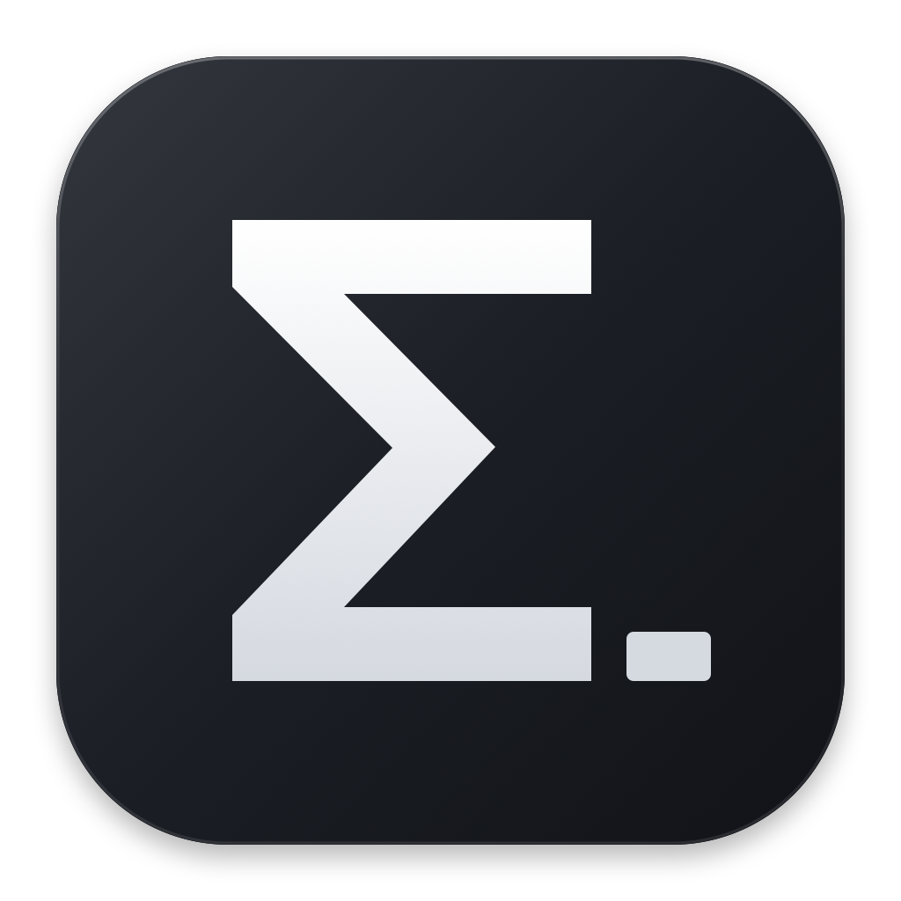
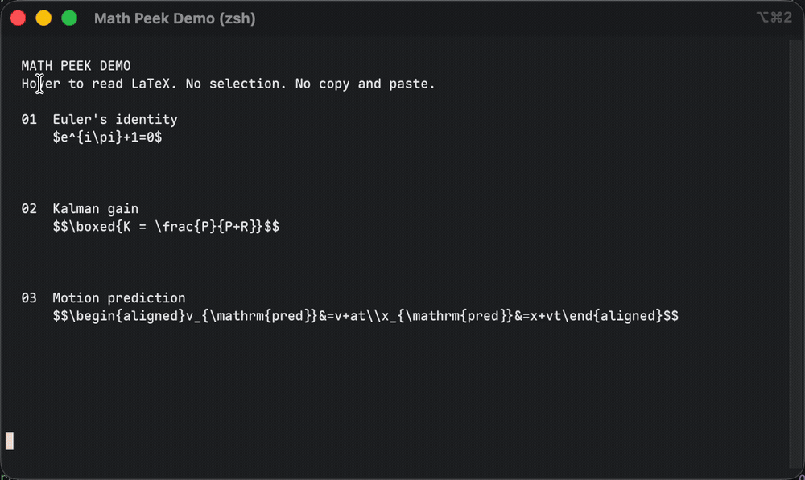

<p align="center"></p>

# Math Peek

Hover over LaTeX in your terminal to see the rendered formula. Math Peek runs in the macOS menu bar and dismisses the preview when you move away.

Requires macOS 13 or later. Supports Apple Silicon and Intel Macs.

[中文](README.zh-CN.md) · [Download](https://github.com/dendenxu/math-peek/releases/latest)



## Install

### Homebrew

```sh
brew install --cask dendenxu/tap/math-peek
open -a "Math Peek"
```

If Homebrew reports an `untrusted tap`, run `brew trust --cask dendenxu/tap/math-peek` and retry.

Quit Math Peek before updating:

```sh
brew upgrade --cask dendenxu/tap/math-peek
```

### Download

Download the ZIP from [Releases](https://github.com/dendenxu/math-peek/releases/latest), extract it, and move `Math Peek.app` to Applications. Each release includes a SHA256 checksum.

The app is not yet notarized by Apple. If macOS blocks the first launch, open System Settings → Privacy & Security and choose Open Anyway.

## First use

1. Open Math Peek and grant Accessibility access so it can read terminal text and character positions.
2. Check that your terminal is enabled in setup, then turn on hover previews.
3. Switch back to your terminal and hover over a formula.

You can close the setup window. Math Peek stays in the `M∑` menu bar, where you can reopen settings, add terminals, or enable Launch at Login.

Hover previews handle common inline and multiline LaTeX, including fractions, matrices, aligned equations, and brace annotations. Large formulas scale to fit; unsupported syntax appears as source text.

## Terminal support

| Terminal | Setup |
| --- | --- |
| iTerm2, Terminal.app | Ready after granting Accessibility; also works with SSH and tmux output |
| cmux | [Connect a local pane](#connect-cmux) |
| Ghostty | [Experimental mode](#connect-ghostty-experimental); connect each local pane |

You can add other terminals in setup. Hover support depends on the terminal's Accessibility interfaces; see the [compatibility notes](docs/terminal-compatibility.md).

### Connect cmux

Run in a local cmux pane:

```sh
math-peek connect cmux
```

Once connected, hover previews are available. Use `Terminal Apps` in the menu bar to check the connection or disconnect.

### Connect Ghostty (experimental)

Run in each local Ghostty pane, outside tmux, screen, or SSH:

```sh
math-peek connect ghostty
```

Reconnect after restarting Math Peek or changing the font, line spacing, or display scaling.

Ghostty mode works best with ordinary terminal output. Full-screen TUIs and frequently redrawn content can produce missing or misplaced previews. See the [Ghostty notes](docs/ghostty-research.md) for details.

## Reader and CLI

Choose `Open Reader` from the menu bar to view a Markdown document or plain LaTeX. `Control-Command-M` reads the selection or visible content from the current terminal; in other apps, it previews the clipboard.

The CLI accepts files, piped input, and clipboard content. It can also capture or follow terminal output:

```sh
math-peek answer.md
cat answer.md | math-peek
math-peek --clipboard
math-peek --capture
math-peek --follow
```

File and pipe input must be UTF-8, up to 2 MB.

## Troubleshooting

- **No popup:** check Accessibility access, the hover switch, and that your terminal is in the foreground. cmux and Ghostty also need a connection.
- **Hover stops after an update:** turn Math Peek's Accessibility switch off and on. If it still reports missing permission, remove the old entry and add the currently installed app again.
- **A formula looks wrong:** scroll the whole formula into view, or copy it into the reader.

Diagnostics are stored in `~/Library/Caches/Math Peek/`. They contain status and timing information, not terminal text.

## Development

Building from source requires Swift 5.9 or later. Recent Xcode Command Line Tools can build directly; older toolchains need full Xcode. Quit Math Peek before installing.

```sh
git clone https://github.com/dendenxu/math-peek.git
cd math-peek
./install.sh
open "$HOME/Applications/Math Peek.app"
```

The source installer places the app in `~/Applications` and the CLI in `~/.local/bin`. Make sure `~/.local/bin` is on your `PATH` to use the CLI.

To run the tests and build a release:

```sh
scripts/test_native.sh
node --test web/core.test.cjs
scripts/build_release.sh
```

`VERSION` controls the version number. Release archives are written to `build/release/`; pushing the matching `v<version>` tag triggers a GitHub Actions release.

Hover rendering uses SwiftMath. The reader uses KaTeX, marked, and DOMPurify. Third-party licenses are included in the app. See the [architecture notes](docs/architecture.md) for implementation details.
