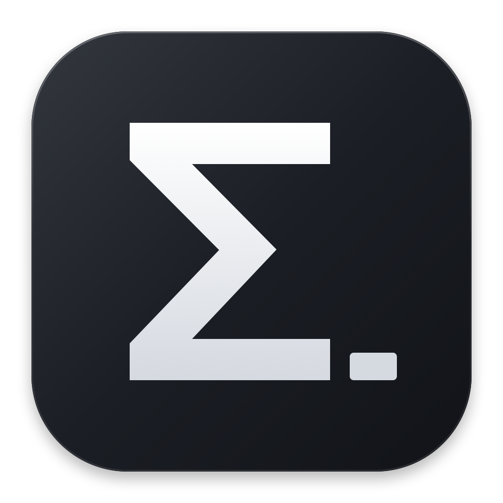
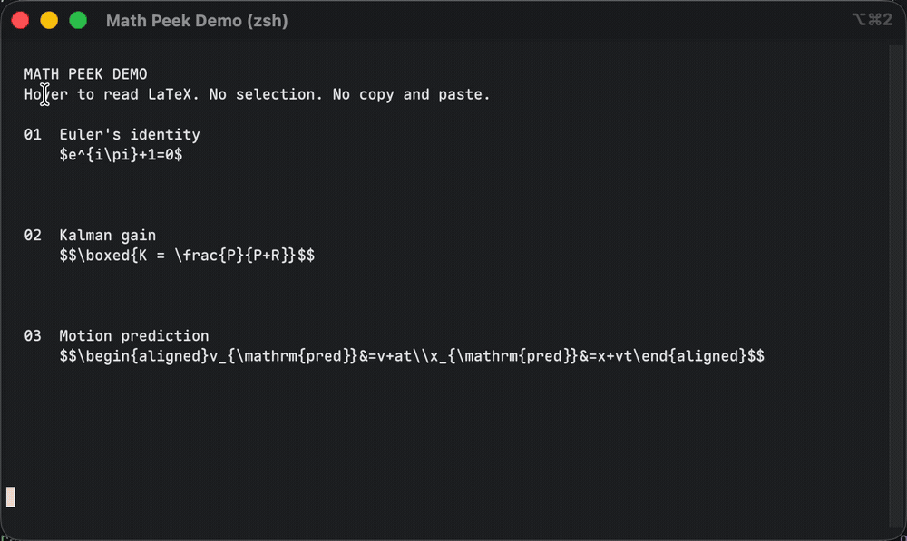

<p align="center"></p>

# Math Peek

把鼠标停在终端里的 LaTeX 上，查看排版后的公式。Math Peek 常驻 macOS 菜单栏，移开鼠标后自动收起预览。

支持 macOS 13 及以上，适用于 Apple Silicon 和 Intel Mac。

[English](README.md) · [下载最新版](https://github.com/dendenxu/math-peek/releases/latest)



## 安装

### Homebrew

```sh
brew install --cask dendenxu/tap/math-peek
open -a "Math Peek"
```

如果 Homebrew 提示 `untrusted tap`，先运行 `brew trust --cask dendenxu/tap/math-peek`，然后重新安装。

更新前先从菜单栏退出 Math Peek，再运行：

```sh
brew upgrade --cask dendenxu/tap/math-peek
```

### 直接下载

从 [Releases](https://github.com/dendenxu/math-peek/releases/latest) 下载 ZIP，解压后将 `Math Peek.app` 拖到“应用程序”。每个版本都附有 SHA256 校验文件。

发布包尚未经过 Apple 公证。如果 macOS 阻止首次打开，可到“系统设置 → 隐私与安全性”中选择“仍要打开”。

## 第一次使用

1. 打开 Math Peek，按提示允许“辅助功能”访问，用来读取终端里的文字和字符位置。
2. 在设置页确认终端已启用，并开启“悬停预览”。
3. 切回终端，将鼠标停在公式上。

设置完成后可以关掉窗口，Math Peek 会留在菜单栏 `M∑` 中。需要时可从菜单栏重新打开设置、添加终端或开启登录启动。

支持常见的行内和多行 LaTeX，包括分式、矩阵、对齐公式和括号注释。较大的公式会自动缩放，暂不支持的语法会显示为源码。

## 终端支持

| 终端 | 使用方式 |
| --- | --- |
| iTerm2、Terminal | 授予辅助功能权限后即可使用，也支持 SSH 和 tmux 中的输出 |
| cmux | [连接本机窗格](#连接-cmux) |
| Ghostty | [实验模式](#连接-ghostty实验模式)，每个本机窗格需单独连接 |

其他终端可以在设置页添加。能否悬停取决于终端提供的辅助功能接口，详见[兼容性说明](docs/terminal-compatibility.md)。

### 连接 cmux

在本机的 cmux 窗格中运行：

```sh
math-peek connect cmux
```

连接成功后即可使用。菜单栏的 `Terminal Apps` 中可以查看连接状态或断开连接。

### 连接 Ghostty（实验模式）

在每个 Ghostty 窗格的本机 shell 中运行（tmux、screen、SSH 会话外）：

```sh
math-peek connect ghostty
```

重启 Math Peek，或修改字体、行距、屏幕缩放后，需要重新连接。

Ghostty 模式适合普通终端输出；全屏 TUI 和频繁重绘的内容可能漏识别或定位不准。详细情况见 [Ghostty 说明](docs/ghostty-research.md)。

## 阅读窗口与命令行

从菜单栏选择 `Open Reader`，可以查看整段 Markdown 或纯 LaTeX。快捷键 `Control-Command-M` 会读取当前终端的选区或可见内容；在其他应用中则预览剪贴板。

也可以通过命令行打开文件、读取剪贴板或跟随终端输出：

```sh
math-peek answer.md
cat answer.md | math-peek
math-peek --clipboard
math-peek --capture
math-peek --follow
```

文件和管道输入须为 UTF-8，最多 2 MB。

## 常见问题

- **没有浮窗**：检查辅助功能权限和悬停开关，并确认终端在前台。cmux 和 Ghostty 还需要完成连接。
- **更新后失效**：在系统辅助功能设置中将 Math Peek 关闭再开启。如果仍提示未授权，再移除旧条目，重新添加当前安装的应用。
- **某个公式显示异常**：先让这条公式完整地出现在视口内，也可以复制到阅读窗口查看。

诊断日志位于 `~/Library/Caches/Math Peek/`，记录运行状态和耗时，不含终端正文。

## 开发与发布

从源码构建需要 Swift 5.9 或更新版本。新版 Xcode Command Line Tools 可以直接构建，旧工具链需要完整 Xcode。安装前请先退出 Math Peek。

```sh
git clone https://github.com/dendenxu/math-peek.git
cd math-peek
./install.sh
open "$HOME/Applications/Math Peek.app"
```

源码安装会将应用放在 `~/Applications`，命令放在 `~/.local/bin`。使用命令行前，请确认 `~/.local/bin` 已加入 `PATH`。

运行测试和构建发布包：

```sh
scripts/test_native.sh
node --test web/core.test.cjs
scripts/build_release.sh
```

版本号由 `VERSION` 管理。发布包输出到 `build/release/`；推送对应的 `v<版本>` 标签会触发 GitHub Actions 发布。

悬停渲染使用 SwiftMath，阅读窗口使用 KaTeX、marked 和 DOMPurify，第三方许可证随应用分发。实现细节见[架构说明](docs/architecture.md)。
